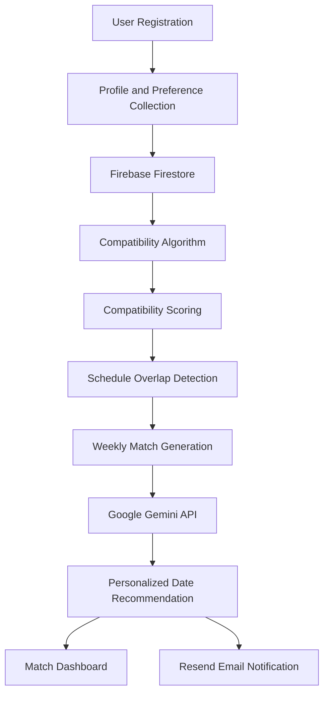

# 💙 UBC Pair

**Meaningful connections. One match at a time.**

A full-stack matchmaking platform designed for University of British Columbia students, delivering one highly compatible match per week through a custom compatibility algorithm, schedule overlap detection, and AI-powered date recommendations.


---

## 🔗 Project Links

- **Live Demo:** [ubc-dating.vercel.app](https://ubc-dating.vercel.app)
- **Devpost:** [UBC Pair](https://devpost.com/software/ubc-pair)

---

## 💡 Inspiration

Modern dating applications often prioritize quantity over quality.
Endless swiping can make forming meaningful connections feel
overwhelming, superficial, and disconnected from real-world interaction.

As UBC students, we wanted to create a more intentional approach
to dating that prioritizes compatibility over volume.

UBC Pair was developed to deliver one thoughtfully selected match
per week, helping students form meaningful connections while
encouraging real-world interactions within the university community.

---

## 🚀 Key Features

### Intelligent Matchmaking

A custom compatibility scoring algorithm evaluates users across
four core dimensions:

- Personality traits and MBTI preferences
- Shared interests and hobbies
- Demographic and relationship preferences
- Schedule availability

Users receive one curated match per week based on compatibility
rather than an endless selection of profiles.

### Schedule Overlap Detection

The platform analyzes user availability to identify mutually
available time slots, reducing scheduling conflicts and
encouraging in-person meetings.

### AI-Powered Date Recommendations

Integrated the Google Gemini API to generate personalized date
ideas based on shared interests and preferences.

Each match receives:

- A mutually available meeting time
- A suggested location on or near UBC campus
- A personalized AI-generated date idea

### Match Management

- Weekly curated matches
- Duplicate match prevention
- User profile and preference management
- Email notifications through Resend

---

## ⚙️ System Architecture



---

## 🧠 Technical Implementation

### Compatibility Scoring Algorithm

Designed a multi-variable matching algorithm that evaluates
compatibility across personality, interests, preferences,
and availability.

The system calculates compatibility scores between potential
matches and uses these scores to determine suitable pairings.

### Schedule Matching

Implemented schedule overlap detection to identify shared
availability between matched users.

This allows the platform to recommend meeting times without
requiring users to manually coordinate their schedules.

### Database Management

Used Firebase Firestore to manage:

- User profiles
- Personality and interest data
- Matching preferences
- Schedule availability
- Match records

### AI Integration

Integrated Google Gemini API to transform user preferences
and shared interests into personalized date recommendations.

Developed and refined prompts to generate relevant,
context-aware suggestions that encourage real-world interaction.

---

## 🛠️ Tech Stack

| Category | Technologies |
|---|---|
| Programming Language | TypeScript |
| Frontend | Next.js, React, Tailwind CSS |
| Backend & Database | Firebase Firestore |
| AI Integration | Google Gemini API |
| Email Services | Resend |
| Deployment | Vercel |
| Version Control | Git, GitHub |
| Algorithms | Compatibility Scoring, Schedule Overlap Detection |

---

## ⚠️ Technical Challenges

- Designing a multi-variable compatibility scoring algorithm.
- Balancing personality, interests, preferences, and availability.
- Preventing duplicate matches across matching cycles.
- Structuring user and match data within Firebase Firestore.
- Integrating external AI services into a full-stack application.
- Refining AI prompts to generate meaningful recommendations.
- Designing an intuitive and accessible user experience.

---

## 🏅 Accomplishments

- Developed a functional end-to-end matchmaking platform.
- Designed a custom multi-variable compatibility algorithm.
- Implemented automated schedule overlap detection.
- Integrated generative AI for personalized recommendations.
- Connected frontend interfaces with a cloud-based database.
- Implemented email notifications through Resend.
- Deployed a publicly accessible web application using Vercel.

---

## 📚 What We Learned

Through developing UBC Pair, we gained practical experience in:

- Full-stack web application development
- Algorithm design and implementation
- Database architecture and data management
- Generative AI and API integration
- Prompt engineering
- Collaborative software development
- Rapid prototyping and iterative debugging
- User-centered product design
- Cloud deployment

---

## 🔮 Future Development

- [ ] UBC email verification
- [ ] Machine learning-based compatibility scoring
- [ ] Improved matching algorithm efficiency
- [ ] Enhanced privacy and moderation features
- [ ] User feedback-based matching improvements
- [ ] Event-based group matching
- [ ] Mobile application support

---

## 👥 Development Team

- Mio Pairotkijja
- Gabriel Su
- Daniel Morgan

---

## 🧪 Getting Started

### Prerequisites

- Node.js
- npm
- Firebase project
- Google Gemini API key
- Resend API key

### Installation

Clone this repository and navigate into the project directory.

Install the required dependencies:

```bash
npm install
```

Configure a `.env.local` file with the environment variables
required by the project's Firebase, Google Gemini, and
Resend integrations.

Start the local development server:

```bash
npm run dev
```

Open the application in your browser:

```text
http://localhost:3000
```

**Security Note:** Never commit API keys, Firebase service account
credentials, private environment files, or personal user data
to the public repository.

---

## 🌎 Our Vision

UBC Pair aims to make technology a bridge to meaningful
human connections rather than a substitute for them.

By combining algorithmic matchmaking, artificial intelligence,
and thoughtful user experience design, we hope to help students
build genuine relationships within their university community.

---

**Built by UBC students, for UBC students. 💙**
